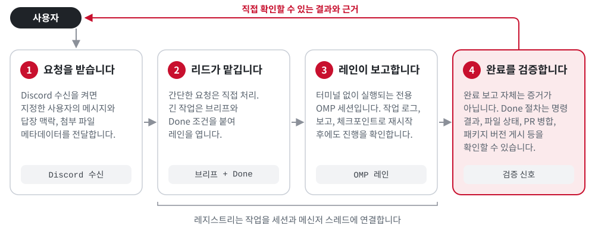

<p align="center">
  
</p>

<h1 align="center">Cataly</h1>

<p align="center">
  <strong>의도를 이해하고 맥락을 읽어 끝까지 해냅니다.</strong>
</p>

<p align="center">
  Cataly는 개발 업무를 함께하는 AI 동료입니다.
  단계별 지시 대신 목표와 지켜야 할 조건을 알려주세요.
  Discord, Telegram, Slack 방에서 요청을 받아 내 컴퓨터의
  <a href="https://omp.sh">OMP</a> 코딩 세션에서 작업하고,
  직접 확인할 수 있는 결과를 돌려줍니다.
</p>

<p align="center">
  <a href="https://github.com/vntrevx/Cataly/releases/latest"></a>
  <a href="https://www.npmjs.com/package/cataly"></a>
  <a href="https://omp.sh"></a>
  <a href="LICENSE"></a>
</p>

<p align="center">
  <a href="#시작하기"><strong>시작하기</strong></a> ·
  <a href="#작동-방식"><strong>작동 방식</strong></a> ·
  <a href="#평소-사용"><strong>평소 사용</strong></a> ·
  <a href="#도움"><strong>도움</strong></a>
</p>

<p align="center">
  <a href="README.md">English</a> · <strong>한국어</strong> · <a href="README.ja.md">日本語</a><br>
  <a href="README.de.md">Deutsch</a> · <a href="README.it.md">Italiano</a> · <a href="README.zh.md">中文</a>
</p>

## 목표부터 알려주세요

<table width="100%"><tr><td>

**요청 예시**

*로그인 테스트가 간헐적으로 실패하는 이유를 찾아줘. 공개 API는 그대로 두고,
관련 테스트를 돌린 다음 원인과 검증 결과를 담아 PR을 열어줘.*

</td></tr></table>

<table>
  <tr>
    <td width="33%" valign="top">
      <h4>의도를 이해합니다</h4>
      간헐적 실패는 증상입니다. 공개 API를 유지하면서 검토할 수 있는 수정안을
      만드는 것이 목표입니다. 목표가 조사 범위를 결정합니다.
    </td>
    <td width="33%" valign="top">
      <h4>맥락을 읽습니다</h4>
      대화, 저장소 관례, 제약, 사용자가 밝힌 선호를 함께 고려합니다. 일상적인
      판단은 Cataly가 맡고, 실질적인 절충이나 권한 판단이 필요할 때는 묻습니다.
    </td>
    <td width="33%" valign="top">
      <h4>끝까지 해냅니다</h4>
      패치가 끝이 아닙니다. 합의한 결과를 확인하고, 근거를 보고하고,
      아직 확인하지 못한 것은 그렇다고 말합니다.
    </td>
  </tr>
</table>

차이는 또 하나의 채팅 화면이 아닙니다. 요청과 작업 세션, 그리고 끝났다는 근거를
하나로 잇는 데 있습니다.

## 작동 방식

<picture>
  <source media="(prefers-color-scheme: dark)" srcset="docs/how-it-works.ko-dark.svg">
  <source media="(prefers-color-scheme: light)" srcset="docs/how-it-works.ko-light.svg">
  
</picture>

1. **요청을 받습니다.** 홈 방(설정 후 `#cataly`)에 글을 쓰면, 내 컴퓨터에서 도는
   Cataly 허브가 답장 맥락과 함께 리드에게 전달합니다.
2. **리드가 맡습니다.** 리드는 오래 이어지는 OMP 세션 하나입니다. 간단한 요청은
   직접 처리하고, 긴 작업은 **레인**을 엽니다. 레인은 자기 작업 폴더(worktree)를 가진
   또 하나의 OMP 세션으로, 브리프와 "PR이 머지됨", "이 명령이 성공함" 같은
   **완료 조건**을 받습니다. 레인마다 스레드가 하나씩 생깁니다.
3. **레인이 작업하고 보고합니다.** 레인은 동시에 여러 개 돌 수 있고, 재시작이나
   업데이트 뒤에도 세션을 이어가서 하던 곳부터 계속합니다.
4. **완료를 검증합니다.** 레인이 끝났다고 말하는 것은 증거가 아닙니다. Cataly가
   완료 조건을 직접 확인하고, 통과한 것과 아직 확인 못 한 것을 알려줍니다.

대화와 별도로 상태 방(`#cataly-ops`)에는 실시간 상황판이 하나 있습니다. 서버 부하,
세션, 제공자 사용량, 감시 작업 상태를 보여줍니다. 감시 작업은 알아둘 만한 것만
올립니다. GitHub 저장소와 PR, 제공자 한도, 서버 부하, 명령으로 확인하는 새 메일,
백업, 상태 점검이 있습니다. 음성을 켜면 Discord 음성 채널에서 리드와 말로 대화할 수
있습니다.

## 통제권은 사용자에게

- Cataly는 사용자의 계정, OMP, 권한으로 일합니다. 알아서 움직인다고 외부 작업
  권한이 생기지는 않습니다.
- 승인은 OMP 자체 설정을 따릅니다. OMP가 물을 때만 방에 버튼으로 질문이 오고,
  글로 답해도 됩니다.
- 설치만으로는 아무것도 실행하거나 설정하지 않습니다. `cataly setup`은 요약을
  보여주고, 사용자가 승인하기 전에는 아무것도 바꾸지 않습니다.
- 음성은 켜기 전까지 꺼져 있고, 사용자의 OpenAI 키를 씁니다.

## 시작하기

<table width="100%"><tr><td>

**Cataly 0.2.0은 새 제품입니다**

이 저장소의 v0.2.0 이전 릴리스와 npm `cataly` 0.2.0 이전 버전은 예전의 다른
제품입니다. 거기서 옮겨오는 것은 없습니다. npm 패키지를 업데이트하면 예전 명령은
사라지고 `cataly`로 바뀝니다. `cataly setup`으로 새로 시작하세요.

</td></tr></table>

### 요구 사항

- Linux 또는 macOS, x86_64 또는 arm64 (Apple Silicon과 Intel Mac). Windows는 지원하지 않습니다.
- [OMP](https://omp.sh) 19.1.1 이상
- Discord 봇(설정 과정에서 만드는 법을 안내합니다), 또는 Telegram이나 Slack 봇
- npm, Bun으로 설치할 때: `PATH`에 Node.js 18 이상

### 설치

하나를 고르세요.

```sh
curl -fsSL https://raw.githubusercontent.com/vntrevx/Cataly/main/install.sh | sh
```

```sh
npm install --global cataly
```

```sh
bun add --global cataly
```

`install.sh`는 최신 정식 릴리스를 받아 해시와 서명을 확인한 뒤 `~/.local/bin`에
`cataly`를 설치합니다. npm과 Bun은 `cataly` 패키지로 같은 실행 파일을 설치합니다.

### 처음 설정

```sh
cataly setup
```

봇 토큰을 묻고 초대 링크를 보여준 다음 나머지를 준비합니다. 홈 방 `#cataly`,
상태 방 `#cataly-ops`, 리드 모델, 승인 버튼, 기본 작업, 그리고 허브를 띄우는 사용자
서비스(Linux는 systemd, macOS는 launchd 에이전트)입니다. 끝나면 `#cataly`에 글을 쓰세요.

## 평소 사용

| 명령 | 하는 일 |
| --- | --- |
| `cataly status` | 허브, 리드, 레인 상태를 한눈에 봅니다. |
| `cataly health` | 아직 고칠 것과 고치는 방법을 알려줍니다. |
| `cataly update` | 허브를 순서대로 멈추고(작업 중인 세션은 끊지 않습니다) 새 버전을 설치한 뒤 다시 띄워 리드와 레인을 이어갑니다. 새 버전이 응답하지 않으면 되돌립니다. |
| `cataly rollback` | 이전 버전으로 돌아갑니다(`install.sh` 설치). |
| `cataly service disable` 후 `cataly uninstall` | 서비스와 프로그램을 지웁니다. 설정(`~/.config/cataly`)과 상태(`~/.local/state/cataly`)는 남깁니다. |

새 릴리스가 나오면 허브가 홈 방에 한 번 알려줍니다. npm이나 Bun으로 설치했다면
설치한 패키지 관리자로 업데이트합니다.

<table width="100%"><tr><td>

**초기 버전**

가장 많이 쓰인 환경은 Linux x86_64이고, macOS와 arm64도 같은 테스트를 통과합니다. Discord(음성 포함)로는 매일 쓰고 있고,
Telegram과 Slack은 테스트는 통과했지만 실제 사용은 아직 적습니다.

</td></tr></table>

## 도움

문제나 아이디어는 [Issues](https://github.com/vntrevx/Cataly/issues)에 남겨주세요.
공개 글에는 토큰, ID, 개인 대화 내용을 넣지 마세요.

소스에서 빌드하거나 기여하려면 [CONTRIBUTING.md](CONTRIBUTING.md)를 보세요.

## 라이선스

Cataly는 [GNU AGPL 3.0](LICENSE) 오픈소스이며, 소스는 이 저장소에 있습니다. AGPL 의무 없이
쓰고 싶다면 [vntrevx](https://github.com/vntrevx)에게 상용 라이선스를 문의해주세요.
Cataly는 별도로 설치하는 [oh-my-pi (OMP)](https://github.com/can1357/oh-my-pi) 위에서
돌아갑니다. 서드파티 라이선스는 모든 릴리스의 `THIRD-PARTY-NOTICES-<target>.txt`에 들어 있습니다.
